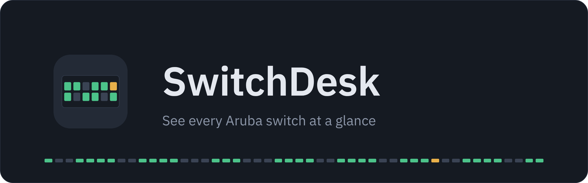
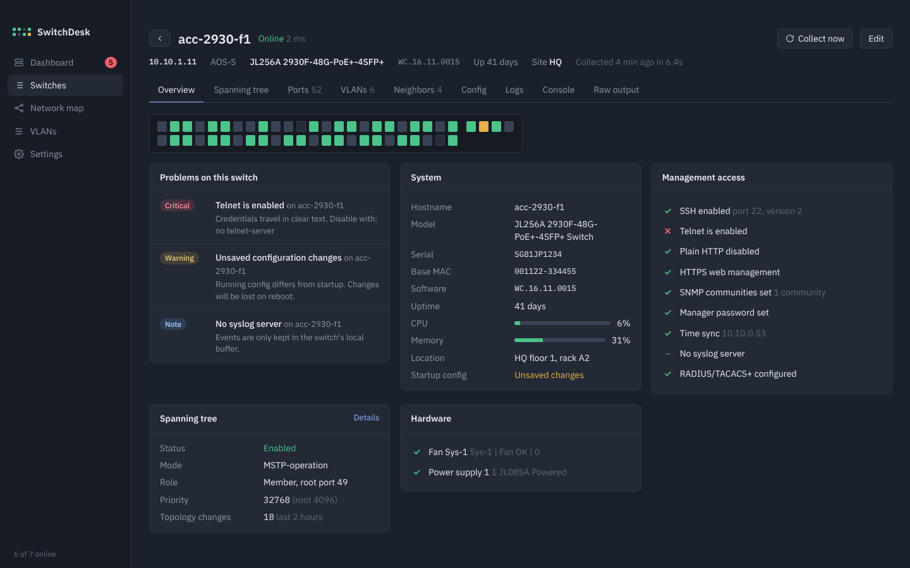
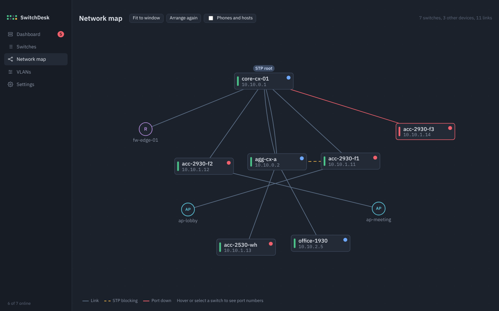

<p align="center">
  
</p>

<p align="center">
  A desktop app for Aruba switches. It logs in over SSH, reads every switch, and shows you what's down, what's misconfigured and how it's all wired together.
</p>

<p align="center">
  
  
  
  
  
</p>

<p align="center">
  
</p>

## Why

One screen for the questions you ask about a switch network every morning: is everything up, did anything change overnight, is spanning tree still sane, and which port goes where. Clicking through web UIs one switch at a time doesn't answer that, and a full NMS is a lot for a few dozen switches. SwitchDesk does the reading over plain SSH and keeps everything on your machine.

## Features

### Dashboard
Online and offline counts, a problem list sorted by severity, and every switch drawn as a faceplate with one LED per port. Green is up, grey is down, amber means spanning tree is blocking it.

### Problems it catches

| Area | Checks |
|---|---|
| Reachability | Switch offline, SSH login failing, SSH host key changed |
| Spanning tree | STP disabled, topology changes since last check, root picked by default priority, more than one root in the network |
| Security | Telnet on, plain HTTP management on, default SNMP community, no manager password |
| Management | No NTP, no syslog, local accounts only, unsaved config |
| Hardware | Fan, power supply and temperature faults, high CPU or memory |
| Logs | Major and error events in the recent log |

### Every switch, in detail

<p align="center">
  
</p>

System facts, a management-access checklist, spanning tree (bridge, root, port roles and states), ports, VLANs, LLDP and CDP neighbors, logs, the running config, and the raw output of every command it ran. Config copies are saved whenever the config changes, and any two can be compared side by side. A console runs `show`, `ping` and `traceroute`, and nothing else.

### VLANs without the CLI
Create, rename and delete VLANs, and set port membership by clicking ports through untagged, tagged and off. Before anything is sent you see the exact commands. Sending stops at the first line the switch rejects, and `write memory` only runs when every line before it went through.

A network-wide matrix shows which switch carries which VLAN and flags names that don't match between switches.

### Network map

<p align="center">
  
</p>

Built from LLDP and CDP and laid out top-down from the spanning-tree root. Drag switches wherever you like and the layout is kept. Blocked links are dashed amber, down links red. Firewalls, access points and switches you don't manage get their own shapes. Phones and hosts stay hidden until you turn them on. Hover a switch to see port numbers on its links, double-click to open it.

### Switch list
Search by name, address, site, model or software, or by state: `offline`, `disabled`, `problem`. Words combine, so `acc offline` finds offline access switches. Press `/` to jump to the search box. Tick switches to collect, disable, enable or delete them together, or use the small buttons at the end of each row. A disabled switch keeps its last data but isn't checked, read or alerted on until you enable it again.

## Supported switches

| Family | Models | Support |
|---|---|---|
| AOS-CX | 6000, 6100, 6200, 6300, 6400, 8xxx | Full |
| AOS-S / ProCurve | 2530, 2540, 2930F/M, 3810, 5400R | Full |
| Instant On | 1830, 1930, 1960 | Reachability and whatever the CLI exposes. VLANs stay in the Instant On portal. |

The only thing the switches need is SSH, plus LLDP if you want the map.

## Install

Download the latest build from **[Releases](https://github.com/jaba0x/switchdesk/releases/latest)**.

### macOS

Get `SwitchDesk-…-macos-universal.zip` (runs on Apple Silicon and Intel), unzip it and drag **SwitchDesk** into Applications. The app isn't notarized by Apple, so the first time right-click it and choose **Open**, or run:

```sh
xattr -dr com.apple.quarantine /Applications/SwitchDesk.app
```

### Windows

Get `SwitchDesk-…-windows-x64.zip`, unzip it and run `SwitchDesk.exe`. If SmartScreen warns about an unknown publisher, choose **More info → Run anyway**. WebView2 is already part of Windows 10 and 11.

### Build it yourself

With Go 1.23+ installed (on a Mac also the Xcode command line tools):

```sh
git clone https://github.com/jaba0x/switchdesk.git
cd switchdesk
./scripts/build-mac.sh          # macOS: builds, installs to /Applications and opens it
.\scripts\build-windows.ps1     # Windows: builds build\bin\SwitchDesk.exe
```

### Releases

The **build** workflow publishes a release with both downloads attached. Push a tag like `v0.2.0`, or run the workflow from the Actions tab and enter a version.

## Getting started

1. **Add a switch** with its address and credentials. **Test connection** shows the hostname and switch family before you save.
2. **Add many** takes one address per line, `name, address` pairs, or ranges such as `10.0.1.20-10.0.1.40`.
3. The first read starts right away. After that, reachability is checked every 30 seconds and each switch is re-read every 15 minutes. Both are adjustable in Settings.

## Your data

Everything stays on your computer, in one folder.

| OS | Default folder |
|---|---|
| macOS | `~/Library/Application Support/SwitchDesk` |
| Windows | `%AppData%\SwitchDesk` |

- `inventory.json` holds switches, settings and map positions. Passwords are encrypted with AES-GCM using a key in `secret.key`, readable only by your user.
- `snapshots/` keeps the last reading of each switch, so the app opens with data.
- `backups/` keeps a copy of a switch's running config each time it changes.

**Choosing another folder.** Settings → Data → Change lets you move the data to another disk or a synced drive, copy it there, or open a folder that already has SwitchDesk data. The key moves with the folder, so the same folder works from any computer that can reach it.

**Moving to another computer.** Settings → Data → Export writes a single `.sdbak` file. Passwords inside are re-encrypted with a passphrase you pick (Argon2id + AES-GCM), so the file is safe to carry around and opens on any machine. On the other computer, Import either adds the file's switches to the ones already there or replaces everything with the file's contents.

SSH host keys are pinned on first connect. If a switch later presents a different key, SwitchDesk stops connecting to it until you confirm on the switch page.

## Development

```sh
go test ./internal/...
wails dev
```

The UI is plain HTML, CSS and JavaScript in `frontend/dist` with no build step. To work on it in a normal browser with sample data, open `frontend/dev/preview.html`.

```
internal/sshx    SSH shell sessions: prompts, paging, escape codes, legacy ciphers
internal/aruba   command sets per family, output parsers, VLAN change builder
internal/core    polling, problem rules, network map
internal/store   inventory, encrypted credentials, snapshots, config copies
```

Parsers are tested against sample output from both AOS-S and AOS-CX. If a switch prints something they misread, the **Raw output** tab shows exactly what came back, and that makes a good test case.

## Credits

Built with [Wails](https://wails.io). Fonts are [IBM Plex](https://github.com/IBM/plex), under the SIL Open Font License.
