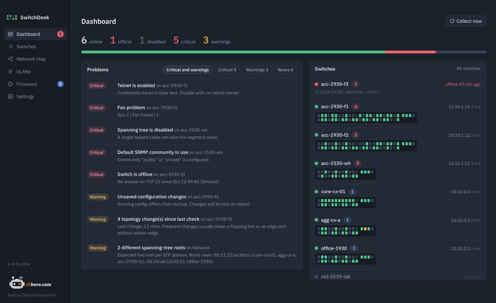

# Dashboard and problems

{ .shot }

The top line counts switches that are online, offline and disabled, plus critical problems and warnings. The bar under it shows the online/offline split at a glance.

**Problems** lists everything that needs attention across all switches. The chips filter it: critical and warnings together (the default), only critical, only warnings, or notes. Click a problem to open its switch.

**Switches** shows each switch as a small faceplate, offline ones first, then by their worst problem. Every LED is a port:

- green: link up
- grey: link down
- amber: blocked by spanning tree
- outlined: port disabled

Hover an LED for the port number, speed, VLAN and description.

## What SwitchDesk checks

### Critical

| Problem | Why it matters |
|---|---|
| Switch is offline | Nothing answers on the SSH port. |
| SSH login failed | Wrong or changed credentials. |
| SSH host key changed | The switch presented a different key than before. SwitchDesk stops connecting until you confirm. See [troubleshooting](troubleshooting.md#ssh-host-key-changed). |
| Spanning tree is disabled | One looped cable can take the segment down. |
| Telnet is enabled | Passwords cross the network in clear text. |
| Default SNMP community | `public` or `private` is configured. |
| No manager password (AOS-S) | Anyone with access gets full rights. |
| Fan, power supply or temperature problem | Hardware fault reported by the switch. |

### Warnings

| Problem | Why it matters |
|---|---|
| Topology changes since last check | Usually a flapping link or an edge port without `admin-edge`. |
| Root bridge elected by default priority | The root was picked by MAC address, not by design. |
| More than one spanning-tree root | Seen across all switches: mixed MST regions or a split segment. |
| Plain HTTP web management (AOS-S) | Web logins aren't encrypted. |
| No NTP/SNTP server | Log times and certificates depend on correct time. |
| Unsaved configuration changes (AOS-S) | Changes are lost on the next reboot. |
| High CPU or memory | Above the limits set in Settings (80% and 90% by default). |
| Major or error events in the log | Taken from the recent log buffer. |
| Data collection failed | SSH worked but reading the switch didn't. |

### Notes

Blocked spanning-tree ports (normal on redundant links), no syslog server, local accounts only, and data older than six hours.

!!! tip
    If default SNMP communities are expected in your network, turn the check off in [Settings](settings.md).
