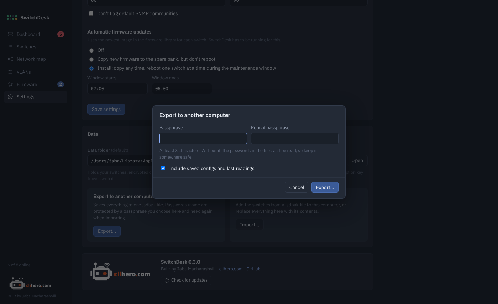

# Your data

Everything SwitchDesk knows stays on your computer, in one folder.

| OS | Default folder |
|---|---|
| macOS | `~/Library/Application Support/SwitchDesk` |
| Windows | `%AppData%\SwitchDesk` |

Inside it:

| Path | Holds |
|---|---|
| `inventory.json` | Switches, credentials, settings and map positions. Passwords are encrypted. |
| `secret.key` | The key that encrypts the passwords, readable only by your user. |
| `snapshots/` | The last reading of each switch, so the app opens with data. |
| `backups/` | Copies of each switch's running config, one per change. |
| `firmware/` | The [firmware library](firmware.md#the-firmware-library). |

## Choose another folder

**Settings → Data → Change…** lets you keep the data elsewhere: another disk, or a synced folder like Dropbox or OneDrive.

- If the folder is empty, choose to **move** your data there (and remove it from the old place) or **copy** it (and leave the old folder as it is).
- If the folder already has SwitchDesk data, choose to **use the data that's there** or **replace it** with yours.

The encryption key moves with the folder, so the same folder opens on any computer that can reach it. **Use default** switches back.

If the chosen folder isn't available when SwitchDesk starts (an unplugged disk, say), it opens the default folder and tells you.

## Move to another computer

{ .shot }

**Export** saves everything into one `.sdbak` file. You pick a passphrase of at least 8 characters, and the passwords inside are encrypted with it (Argon2id and AES-GCM), so the file is safe to carry around. Saved configs and the last readings can be included or left out.

On the other computer, **Import** asks for the passphrase, shows what's in the file, and then either:

- **adds** its switches to the ones already there (switches with the same address and port are skipped), or
- **replaces** everything with the file's contents.

!!! warning
    Keep the passphrase somewhere safe. Without it, the passwords in the file can't be read.

## Security

- Passwords are encrypted at rest with AES-GCM and are never shown again after you save them.
- SSH host keys are pinned on first connect. A changed key stops SwitchDesk from connecting until you confirm.
- The console only runs `show`, `ping` and `traceroute`.
- Configuration changes only happen when you start them, and you see the commands first.
- Nothing leaves your computer except SSH to your switches, HTTPS to AOS-CX switches while a firmware update uploads, TFTP only as a fallback, and the update check against GitHub.
