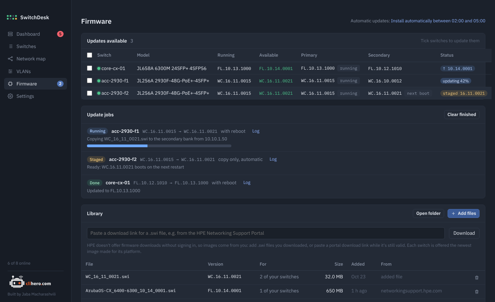
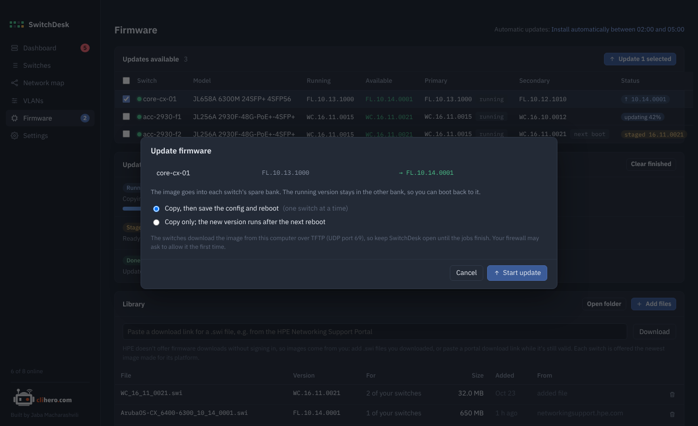

# Firmware updates

SwitchDesk shows which firmware each switch runs, what sits in its two boot banks, and whether your firmware library holds something newer for it. It can update one switch, many, or all of them on a schedule.

{ .shot }

## How a switch gets its firmware

Aruba switches keep two images: **primary** and **secondary**. One is running, the other is spare. SwitchDesk always writes the new image into the spare bank, so the version you run today stays on the switch as a fallback.

An update goes like this:

1. Read both banks to see which one is running.
2. Copy the image into the spare bank (see below for how).
3. Read the banks again and check the new version is really there.
4. Make the spare bank the boot default.
5. If you asked for a reboot: save the config, reboot from the new bank, wait for the switch to come back, read it, and confirm it runs the new version.

### How the image gets to the switch

**AOS-S** gets the image uploaded over **SSH**: SFTP, or SCP on older firmware, straight into `/os/primary` or `/os/secondary`. It uses a second SSH connection that SwitchDesk opens to the switch, the same way it logs in for everything else, so the switch never has to reach your computer. This works over a VPN or zero trust access.

The switch only accepts uploads with `ip ssh filetransfer` turned on, and turning it on also switches off its TFTP client and server. SwitchDesk reads the running config first, turns file transfer on for the upload, and then restores what was there before. The job log lists the exact commands it ran to put things back.

**AOS-CX**, and any AOS-S switch that refuses the upload, pulls the image from your computer over **TFTP** (UDP port 69) instead. SwitchDesk runs its own small TFTP server only while an update is copying, and it only serves the image that's being installed. For this the switch has to be able to reach your computer. That isn't possible over most VPN and zero trust setups, and the job then fails with `Exceeded 5 retransmits` or `Peer unreachable`.

!!! warning "Keep SwitchDesk open"
    SwitchDesk sends or serves the image, so it has to keep running until the jobs finish. For TFTP, your Mac or Windows firewall may ask the first time whether to allow SwitchDesk to accept connections. Allow it.

## The firmware library

HPE doesn't offer firmware downloads without signing in to the HPE Networking Support Portal, so SwitchDesk can't fetch new versions by itself. You put images in the library, and SwitchDesk does the rest.

- **Add files** copies `.swi` files you downloaded into the library.
- **Download** takes a download link copied from the support portal and fetches it. Portal links expire after a while; if the download fails, copy a fresh one.
- **Open folder** shows the library folder. Files you drop there by hand are picked up too.

Each image is matched to switches by its platform code, the two letters at the start of the version: `WC` for 2930F, `YA` for 2530, `KB` for 3810 and 5400R, `FL` for 6300 and 6400, `PL` for 6000 and 6100, and so on. SwitchDesk reads the code from the file name (like `WC_16_11_0021.swi`), from AOS-CX file names (like `ArubaOS-CX_6400-6300_10_14_0001.swi`), or from inside the image. The **For** column shows how many of your switches an image fits.

Each switch is offered the newest image for its platform. In the switch list, the **Firmware** column shows:

| Badge | Meaning |
|---|---|
| `↑ 16.11.0021` | A newer version is in the library |
| `staged 16.11.0021` | It's already in the spare bank and boots on the next restart |
| `updating 42%` | A job is copying it right now |
| `update failed` | The last attempt failed; hover for the reason |

## Update switches

Start an update from the **Firmware** page (tick switches, then **Update selected**), from the switch list (the up-arrow at the end of a row, or **Update firmware** for selected switches), or from the firmware card on a switch page.

{ .shot }

Choose:

- **Copy, then save the config and reboot.** The full update. With several switches, only one reboots at a time, so the network is never missing more than one switch.
- **Copy only.** The new version is staged and starts the next time the switch reboots, whenever suits you. A staged switch shows **Install now** on its page, which does just the reboot.

**Update jobs** shows each update's progress, current step, and a log with every command and answer. Jobs that haven't started can be cancelled.

## Automatic updates

In **Settings → Automatic firmware updates**:

- **Off.** Nothing happens until you start it.
- **Copy new firmware to the spare bank, but don't reboot.** As soon as a newer image lands in the library, every matching switch gets it staged.
- **Install.** Images are staged any time; reboots only happen inside the maintenance window (02:00 to 05:00 by default, and the window can cross midnight), one switch at a time.

SwitchDesk looks for work every five minutes while it's running. If an update fails, that version isn't retried on that switch for 24 hours.

!!! tip "Try it on one switch first"
    Before letting automatic mode loose, update one switch you can reach on the console, and check its log in **Update jobs**.

## Not supported

Instant On switches are updated from the Instant On portal or app.
