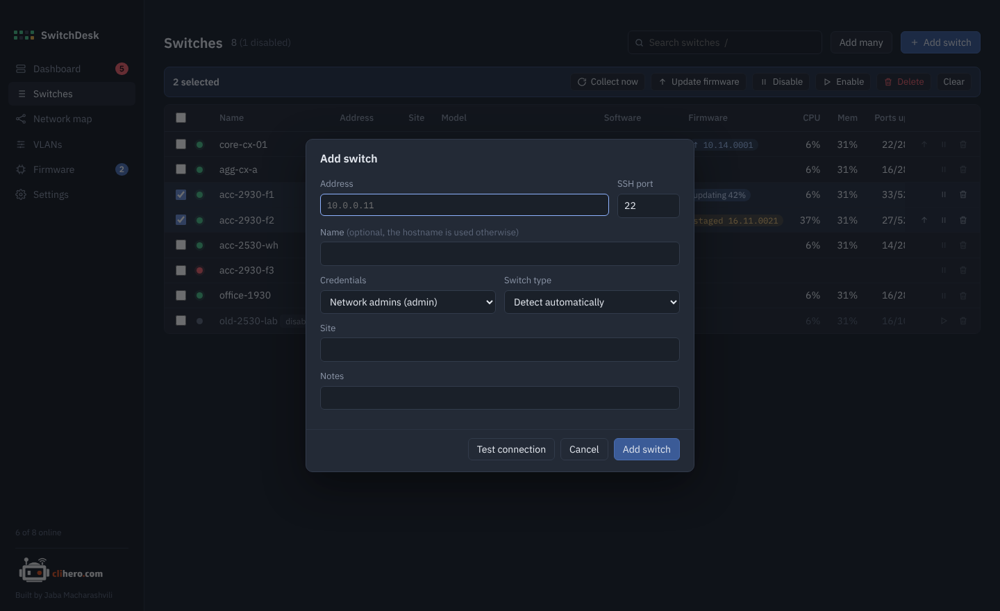
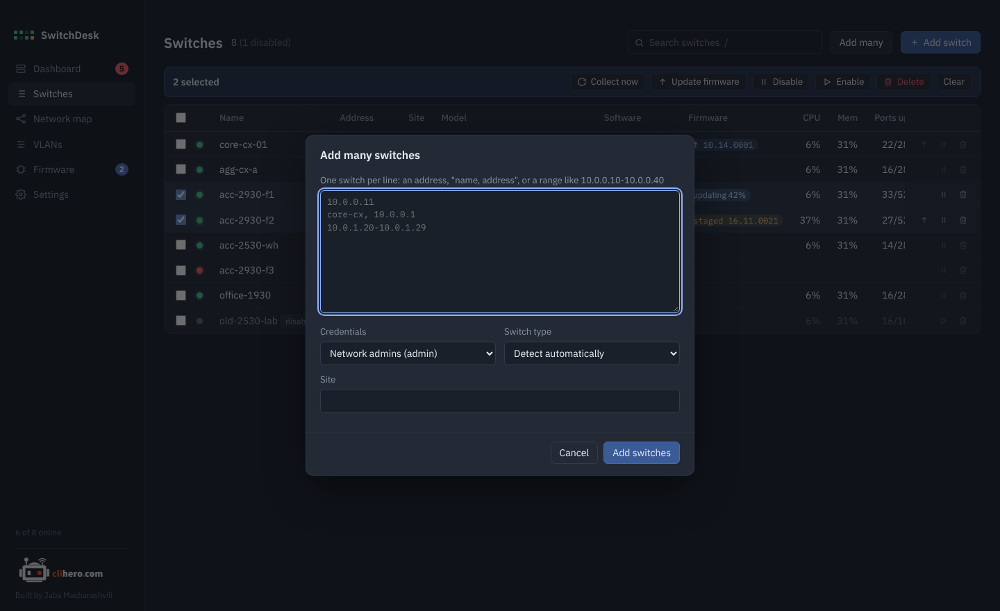

# First steps

## Add a switch

Open **Switches** and click **Add switch**.

{ .shot }

- **Address** is the IP or hostname you'd SSH to. Change the port if the switch doesn't use 22.
- **Name** is optional. Without one, SwitchDesk uses the hostname it reads from the switch.
- **Credentials** are shared sets of username and password. Pick an existing one or choose *New credentials…* to add one right there.
- **Switch type** can stay on *Detect automatically*. SwitchDesk reads `show version` and works out whether it's AOS-CX, AOS-S or Instant On.
- **Site** and **Notes** are for you. Site is searchable.

**Test connection** logs in and shows the hostname, family and SSH host key before you save, so typos show up straight away.

The first reading starts as soon as you save.

## Add many at once

**Add many** takes one switch per line:

{ .shot }

```text
10.0.1.11
core-cx, 10.0.0.1
10.0.1.20-10.0.1.40
10.0.2.5 office-1930
```

Each line can be a plain address, `name, address`, `address name`, or a range of addresses in the same subnet. All of them get the credentials, type and site you pick below the list. Addresses already in SwitchDesk are skipped and listed.

## What happens next

Once a switch is added, SwitchDesk:

1. checks it can reach the switch's SSH port every 30 seconds,
2. logs in and reads the switch every 15 minutes (and right away the first time),
3. keeps a copy of the running config each time it changes,
4. raises anything that needs attention on the [dashboard](dashboard.md).

Both intervals can be changed in [Settings](settings.md). **Collect now** on the dashboard or on a switch page reads immediately.

## What SwitchDesk runs on your switches

Reading a switch only uses `show` commands, plus `no page` to turn off paging for the session. The full list is in the **Raw output** tab of every switch, next to what each command returned.

Changes only happen when you ask for them: VLAN edits (shown to you first) and firmware updates.

## Keyboard

| Key | Does |
|---|---|
| ++slash++ | Jump to the switch search |
| ++esc++ | Close a dialog |
| ++arrow-up++ / ++arrow-down++ | Previous commands in the console |
