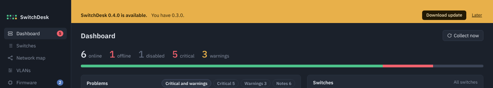

# Install

Download the latest build from the [releases page](https://github.com/jaba0x/SwitchDesk/releases/latest). Every release has a Mac and a Windows download.

=== "macOS"

    1. Download `SwitchDesk-…-macos-universal.zip`. It runs natively on both Apple Silicon and Intel Macs.
    2. Unzip it and drag **SwitchDesk** into **Applications**.
    3. The app isn't notarized by Apple, so the first time you open it, right-click it and choose **Open**, then **Open** again in the dialog.

    If macOS says the app is damaged or can't be checked, clear the download flag in Terminal:

    ```sh
    xattr -dr com.apple.quarantine /Applications/SwitchDesk.app
    ```

=== "Windows"

    1. Download `SwitchDesk-…-windows-x64.zip` (Windows 10 or 11, 64-bit).
    2. Unzip it anywhere you like and run `SwitchDesk.exe`.
    3. If SmartScreen warns about an unknown publisher, choose **More info**, then **Run anyway**.

    SwitchDesk uses Microsoft Edge WebView2, which is already part of Windows 10 and 11.

## Updating

When a newer release is out, SwitchDesk shows a yellow bar at the top of the window:

{ .shot }

**Download update** opens the release page. Install the new version the same way as the first one; your switches, credentials and settings stay where they are. **Later** hides the bar until the next version comes out.

SwitchDesk checks GitHub when it starts and every six hours after that. You can also check by hand under **Settings → Check for updates**.

!!! note
    The update check was added in version 0.4.0. If you're on an older version, install the latest one once by hand.

## Build it yourself

You need Go 1.23 or newer. On a Mac you also need the Xcode command line tools (`xcode-select --install`).

```sh
git clone https://github.com/jaba0x/SwitchDesk.git
cd SwitchDesk
```

=== "macOS"

    ```sh
    ./scripts/build-mac.sh
    ```

    This builds a universal app, copies it to `/Applications` and opens it. Run it again after `git pull` to update.

=== "Windows"

    ```powershell
    .\scripts\build-windows.ps1
    ```

    The exe ends up in `build\bin\SwitchDesk.exe`.

Both scripts install the [Wails](https://wails.io) command line tool if it's missing and run the tests before building.
