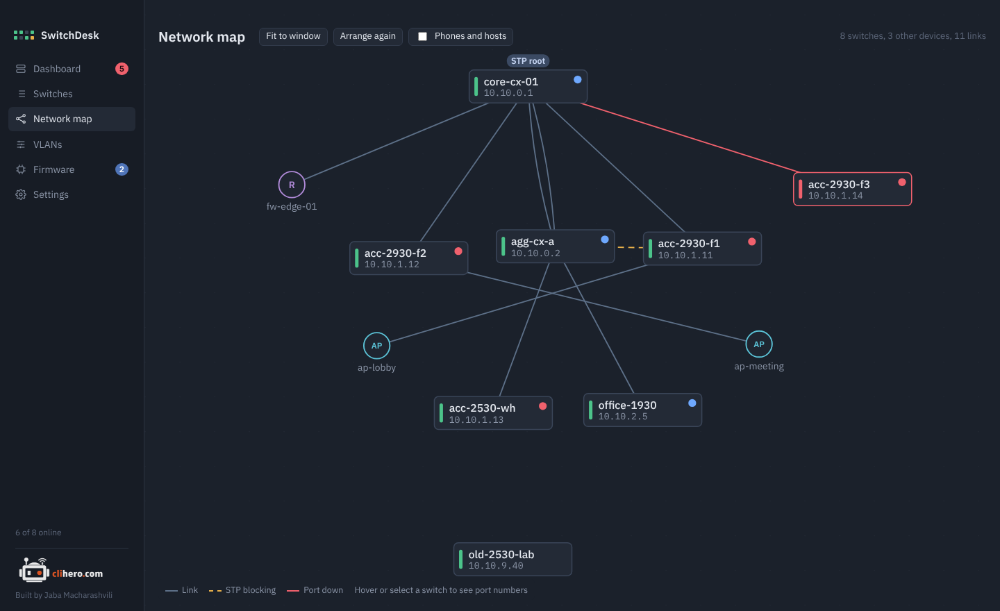

# Network map

{ .shot }

The map is built from what each switch sees over LLDP and CDP. Neighbors are matched to switches in SwitchDesk by chassis MAC first, so a link reported from both ends is drawn once. A matching management address or hostname only counts if the MAC agrees, or if the other switch reports the link back. Branches that reuse the same private subnets therefore don't get links drawn between them.

## Layout

The map starts at the spanning-tree root (marked **STP root**) at the top and places switches in rows by how many hops away they are. If no root is known, the most connected switch goes on top.

- **Drag** a switch to move it. Positions are saved and come back next time.
- **Scroll** to zoom, drag the background to pan.
- **Fit to window** brings everything into view.
- **Arrange again** forgets saved positions and lays the map out fresh.

## Reading it

| You see | It means |
|---|---|
| Green bar on a box | Switch online |
| Red bar and red border | Switch offline |
| Grey bar | Switch disabled in SwitchDesk |
| Coloured dot, top right | Worst problem on that switch (red critical, amber warning, blue note) |
| Grey line | Link up |
| Dashed amber line | Spanning tree blocks this link |
| Red line | The port is down |

Devices that aren't in SwitchDesk appear as circles: **R** for routers and firewalls, **AP** for access points, **S** for other switches. Phones (**P**) and hosts (**H**) are hidden unless you tick **Phones and hosts**.

Hover or click a switch to show port numbers on its links. Clicking also opens a card listing each link (this port, the other device, its port) with **Open switch**. Double-click a switch to go straight to its page.

!!! tip
    A switch missing from the map usually has LLDP turned off, or its neighbors do. On AOS-S, `lldp run` enables it; AOS-CX runs LLDP by default.
