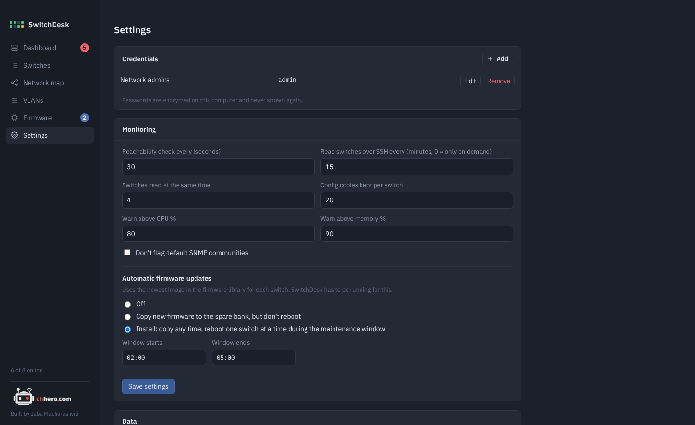

# Settings

{ .shot }

## Credentials

Shared username and password sets. Add as many as you need and pick one per switch. Editing a set and leaving the password empty keeps the old one. A set that's still in use can't be removed.

## Monitoring

| Setting | Default | What it does |
|---|---|---|
| Reachability check every | 30 seconds | How often each switch's SSH port is tried. Drives online/offline. |
| Read switches over SSH every | 15 minutes | How often each switch is logged in to and read. 0 means only when you click **Collect now**. |
| Switches read at the same time | 4 | Up to 16. Higher is faster on big networks. |
| Config copies kept per switch | 20 | Older copies are deleted. |
| Warn above CPU % | 80 | |
| Warn above memory % | 90 | |
| Don't flag default SNMP communities | off | For networks where `public` is expected. |

## Automatic firmware updates

Off, copy only, or install inside a maintenance window. See [Firmware updates](firmware.md#automatic-updates).

## Data

The data folder, export and import. See [Your data](data.md).

## About

The version you run, a link to [clihero.com](https://clihero.com) and the GitHub repository, and **Check for updates**.
