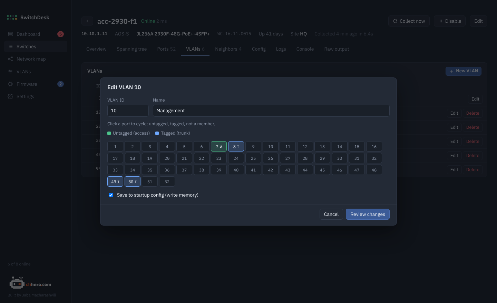
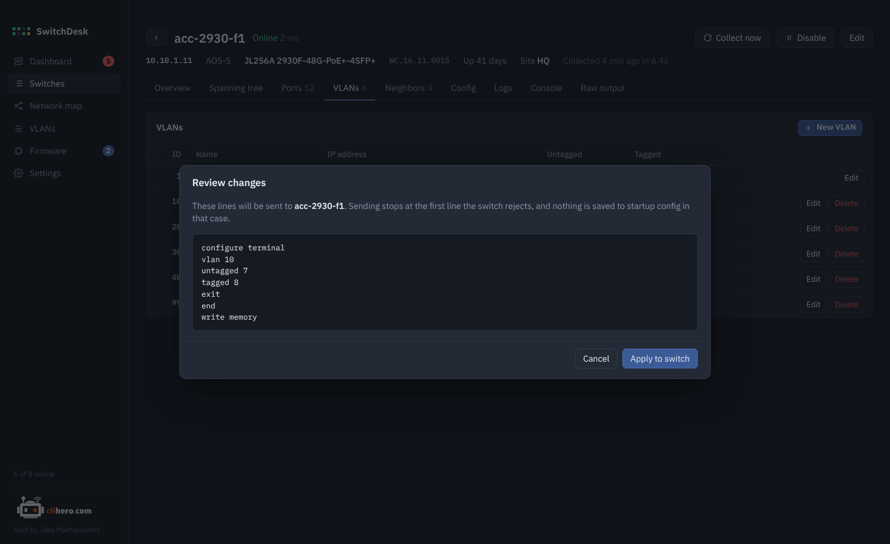
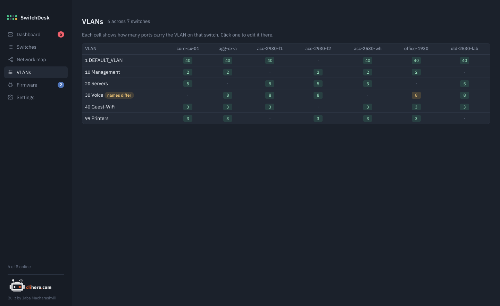

# VLANs

## On one switch

The **VLANs** tab of a switch lists its VLANs with name, IP address, and untagged and tagged ports. **New VLAN**, **Edit** and **Delete** change them. VLAN 1 can't be deleted.

### Edit ports by clicking

{ .shot }

Each port is a button. Clicking cycles it through:

- **U** untagged (an access port in this VLAN)
- **T** tagged (a trunk carrying this VLAN)
- off (not a member)

Change the name in the same dialog. **Save to startup config** runs `write memory` at the end, so the change survives a reboot; untick it to try something out first.

### Review before sending

{ .shot }

**Review changes** shows the exact lines that will be sent, for example on AOS-S:

```text
configure terminal
vlan 10
untagged 7
tagged 8
exit
end
write memory
```

and on AOS-CX:

```text
configure terminal
vlan 30
exit
interface 1/1/49
no routing
vlan trunk allowed 30
exit
end
```

**Apply to switch** sends them one by one and shows the switch's replies. If the switch rejects a line, SwitchDesk stops there, and `write memory` is never reached, so nothing half-done gets saved. Afterwards the switch is read again so the tables update.

!!! note "Instant On"
    Instant On switches don't take VLAN changes over SSH. Change them in the Instant On portal or app.

## Across the network

{ .shot }

The **VLANs** page lists every VLAN on every switch. Each cell shows how many ports carry that VLAN there; a dot means the switch doesn't have it. When the same VLAN ID has different names on different switches, the row is marked **names differ** and the odd ones out are highlighted. Click a cell to open that switch's VLAN tab.
